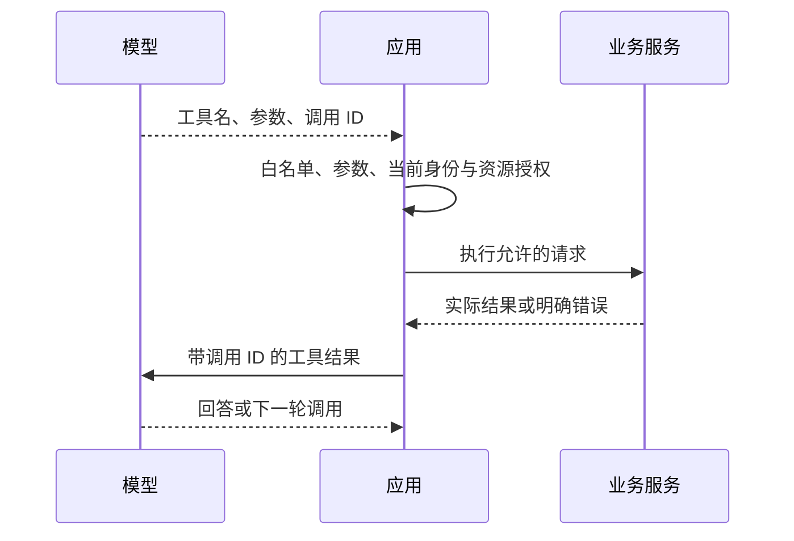

## 1. 工具调用的执行边界

**Function Calling / Tool Calling（函数或工具调用）**让模型输出结构化的能力请求。应用把工具名、用途和参数结构提供给模型；模型返回调用意图；应用验证后执行；最后把结果与调用标识一起传回模型。客户端工具实际运行在应用侧，供应商内置工具则可能运行在供应商侧。

本节主讲自定义工具，环境为 Node.js 22+，不连接真实业务系统。协议字段参考 2026-10-20 的 Anthropic 工具文档，实验内部的 call 对象是教学模型，不是实际 API 请求体。

## 2. 如何设计一个好工具

| 要素        | 定义                         | 例子及作用                                   |
| ----------- | ---------------------------- | -------------------------------------------- |
| 名称与描述  | 说明何时选用及职责范围       | get_order 查询单个订单；不同时承担删除和查询 |
| 参数 schema | 描述输入字段与约束           | orderId 是 O- 开头的字符串                   |
| Call ID     | 关联模型请求与执行结果       | c1 的结果只能回给 c1                         |
| 结果契约    | 让模型区分成功、无数据和失败 | not_found 与 unavailable 不混淆              |
| 资源级授权  | 判断当前身份可否操作该资源   | 登录的 u1 只能读取自己的订单                 |

工具描述应包含必要参数、缺信息处理和边界。返回最少但足够的信息，例如订单状态、数据时间与来源 ID；不要把整个数据库记录、内部令牌或堆栈一并发给模型。

## 3. 一次真实协议交互如何衔接

在 Messages API 中，请求的 tools 使用 `name`、`description`、`input_schema`。响应可包含 `tool_use` 块，带 id/name/input；应用保留 assistant 的完整内容块，再发送对应的 `tool_result`，用 tool_use_id 关联原 id。一次响应可能请求多个工具，必须为每个调用安排结果或明确失败，不能只处理第一项。



## 4. 完整实验：合法参数也可能越权

先预测：u1 知道 u2 的订单号后，能读取订单吗？保存为 `tools.mjs`，运行 `node tools.mjs`：

```js
import assert from 'node:assert/strict';
const orders = new Map([
  ['O-1', { owner: 'u1', status: 'shipped' }],
  ['O-2', { owner: 'u2', status: 'pending' }],
]);
const executions = [];

/**
 * 从应用身份授权，绝不信任模型提供的用户身份。
 */
function execute(call, session) {
  if (!call || typeof call.id !== 'string') return { error: 'invalid_call' };
  if (call.name !== 'get_order') return { id: call.id, error: 'unknown_tool' };
  const args = call.input;
  if (
    !args ||
    Object.keys(args).length !== 1 ||
    typeof args.orderId !== 'string' ||
    !/^O-\d+$/.test(args.orderId)
  ) {
    return { id: call.id, error: 'invalid_input' };
  }
  const row = orders.get(args.orderId);
  if (!row || row.owner !== session.userId) {
    return { id: call.id, error: 'not_found_or_forbidden' };
  }
  executions.push(args.orderId);
  return { id: call.id, data: { orderId: args.orderId, status: row.status } };
}

const session = { userId: 'u1' };
const call = { id: 'c1', name: 'get_order', input: { orderId: 'O-1' } };
assert.equal(execute(call, session).data.status, 'shipped');
assert.equal(
  execute({ ...call, input: { orderId: 'O-2' } }, session).error,
  'not_found_or_forbidden',
);
assert.equal(
  execute({ ...call, name: 'delete_order' }, session).error,
  'unknown_tool',
);
assert.equal(
  execute({ ...call, input: { orderId: 'O-1', userId: 'u2' } }, session).error,
  'invalid_input',
);
assert.deepEqual(executions, ['O-1']);
console.log('1 authorized execution; 3 rejected suggestions');
```

## 5. 预期结果与原因

只有第一次调用进入执行记录：订单存在且属于当前会话。第二次虽然语法合法，但资源不属于用户；第三次不在工具白名单；第四次试图额外传入身份字段，被拒绝。对外统一不可读结果可减少资源枚举风险，内部仍要记录实际拒绝原因。

查询结果应保留来源和必要的更新时间；写入工具应增加用户确认、幂等键及业务校验。**幂等**指同一业务请求重复到达，不会重复造成副作用；call ID 通常只标识某轮调用，不能自动充当跨重试业务幂等键。

## 6. 错误与恢复边界

错误做法是把工具映射成 `eval(modelCode)`，或把模型传来的 userId 直接用于授权。它们分别允许任意代码执行与身份冒用。修正为有限的工具注册表、固定处理函数和可信会话身份。

参数错误可以向模型返回简短纠正信息；未知资源通常应追问或告知无数据；权限失败不能要求模型换身份重试；临时网络故障才考虑有限退避。存在写入依赖的工具不能为了加速随意并行。

## 7. 练习与验收

1. 增加只读 get_stock 工具。验收：未知 SKU、错误参数和成功查询分别有结果，工具职责不重叠。
2. 同一轮处理两个调用。验收：结果保留各自 ID，一项失败不被写成另一项成功。
3. 设计取消订单工具。验收：授权、可取消状态、确认内容和业务幂等键均由服务端检查。

## 8. 资料链接

- [Anthropic：工具执行位置与调用过程](https://platform.claude.com/docs/en/agents-and-tools/tool-use/overview)
- [Anthropic：工具接口设计](https://www.anthropic.com/engineering/building-effective-agents)
