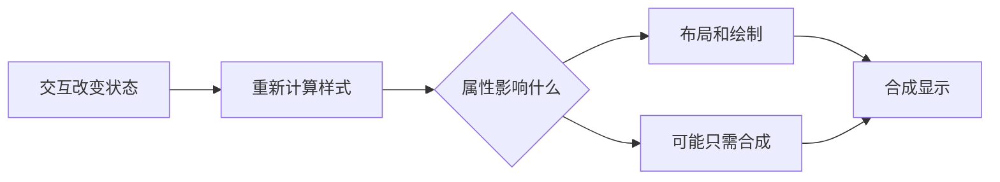

## 1. 动画应该解释状态变化

过渡让两个状态之间平滑变化，关键帧动画描述一个时间序列。它们的价值是帮助用户理解变化，不是增加页面移动次数。性能也不是“用了 transform 就一定快”：仍要考虑元素大小、图层、绘制成本和设备能力。

本节需要已理解盒模型、层叠与用户偏好。实验只使用浏览器；性能结果取决于设备，因此给出测量方法，不编造固定帧率。

## 2. 状态、时间和渲染阶段

| 术语       | 定义                                   | 为什么关心                           |
| ---------- | -------------------------------------- | ------------------------------------ |
| transition | 某个属性计算值变化时，在持续时间内插值 | 需要起点、终点与可动画属性           |
| keyframes  | 用时间位置描述多个状态                 | 适合循环提示或明确的运动序列         |
| layout     | 计算盒子尺寸与位置                     | 改宽高可能影响许多后代和兄弟         |
| paint      | 将文字、背景等绘制为图像               | 大阴影、大区域重绘可能昂贵           |
| composite  | 把图层组合显示                         | 某些变换可只进行合成，但不是绝对保证 |



这是理解成本的概念图，真实浏览器会跳过不需要的阶段，也可能因图层策略变化重新绘制。

## 3. 完整实验：一个可展开面板

先预测：为什么这里不使用 `transition:all`，也不把高度硬编码为固定数字？保存为 `motion.html`：

```html
<!doctype html>
<meta charset="utf-8" />
<title>状态与动画</title>
<style>
  :root {
    --space: 16px;
    --accent: #087f5b;
  }
  body {
    padding: var(--space);
    font: 16px/1.6 sans-serif;
  }
  button {
    padding: 8px 16px;
    border: 2px solid var(--accent);
  }
  button:focus-visible {
    outline: 3px solid #1864ab;
  }
  .panel {
    padding: var(--space);
    border-left: 4px solid var(--accent);
  }
  .panel[hidden] {
    display: none;
  }
  @media (prefers-reduced-motion: no-preference) {
    .panel {
      animation: appear 0.2s ease-out;
    }
    @keyframes appear {
      from {
        opacity: 0;
        transform: translateY(-6px);
      }
      to {
        opacity: 1;
        transform: none;
      }
    }
  }
</style>
<button type="button" aria-expanded="false" aria-controls="panel">
  展开说明
</button>
<section id="panel" class="panel" hidden>
  内容由正常流撑开，长文案不会被固定高度裁掉。
</section>
<script>
  const button = document.querySelector('button');
  const panel = document.querySelector('#panel');
  button.addEventListener('click', () => {
    panel.hidden = !panel.hidden;
    button.setAttribute('aria-expanded', String(!panel.hidden));
  });
</script>
```

预期首次点击显示面板并短暂淡入；再次点击立即隐藏。这里有意没有实现退出动画：`display:none` 会移除布局盒，要实现退出过渡需要协调动画完成与隐藏状态，并处理快速重复操作，不能只添加一条 transition 期待浏览器代办整个生命周期。

## 4. 怎样验证动画成本

开发工具 Performance 录制点击过程，查看长任务、Layout、Paint 和合成活动。再把 transform 改成会影响位置布局的属性作对照。每次保持相同内容与设备条件；性能结论应基于真实记录。

如果 JS 每次读取 `offsetWidth`，接着写样式，再读下一个元素尺寸，可能强制反复布局。改为先批量读，再批量写。`requestAnimationFrame` 把更新安排到下一帧附近，但不会让一次很重的计算自动变轻。

## 5. 样式组织与错误模式

自定义属性 `--accent` 表达主题变量，组件使用它而不复制颜色值。按组件职责组织类，少用依赖整个页面层级的选择器。抽取公共样式的依据是稳定的语义复用，不是出现两次相同数字。

常见失败包括：`transition:all` 意外让尺寸也动画；永久设置 `will-change` 制造过多图层与内存开销；为减少动画删掉状态文本；只在 hover 时提供信息，键盘用户无法得到。修复时限定属性、控制动画范围，并保留不依赖运动的状态反馈。

## 6. 练习与验收

1. 为按钮文字同步“展开/收起”，验收快速点击时 aria-expanded 与面板实际状态一致。
2. 实现一个确实需要退出动画的版本。提示：区分“正在退出”和“已隐藏”；验收中途反向操作不留幽灵内容或重复监听器。
3. 录制两种动画实现的性能轨迹。验收说明观察到哪些渲染阶段，不能只报一个无上下文的 FPS。

## 7. 资料链接

- [MDN：CSS 过渡](https://developer.mozilla.org/en-US/docs/Web/CSS/CSS_transitions/Using_CSS_transitions)
- [MDN：CSS 动画](https://developer.mozilla.org/en-US/docs/Web/CSS/CSS_animations/Using_CSS_animations)
- [MDN：will-change](https://developer.mozilla.org/en-US/docs/Web/CSS/will-change)
