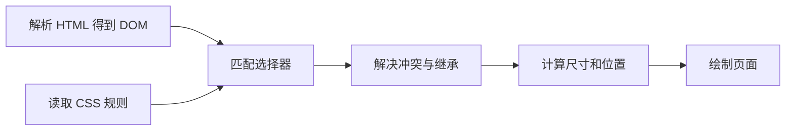

## 1. CSS 到底在做什么

CSS（层叠样式表）把 HTML 的结构转为可见的样式。HTML 负责“这是按钮还是标题”，CSS 负责颜色、尺寸和布局。不要为了外观把标题全部写成 `div`：语义会影响键盘、读屏和默认行为，CSS 不能补回丢失的语义。

本节需要会保存 HTML 文件并用浏览器打开。示例不依赖框架；使用当前稳定版浏览器，学习目标是把“样式不生效”拆成能核对的几个步骤。

## 2. 先掌握这些术语

| 术语     | 含义与用途                     | 最小例子与结果                                  |
| -------- | ------------------------------ | ----------------------------------------------- |
| 规则     | 选择器加声明块                 | `.note { color: teal; }` 修改匹配元素的文字颜色 |
| 选择器   | 决定声明作用于哪些元素         | `.list > li` 只匹配直接子项                     |
| 属性与值 | 描述一种表现及其具体取值       | `padding: 8px` 在内容周围增加内边距             |
| 伪类     | 匹配状态或结构关系             | `button:focus-visible` 匹配需要可见焦点的按钮   |
| 伪元素   | 表示元素的一部分或生成内容     | `p::first-letter` 修改段落首字母                |
| DOM      | 浏览器解析 HTML 后形成的节点树 | 嵌套结构决定后代选择器能否匹配                  |

`.a .b` 是任意层级后代，`.a > .b` 是直接子元素，`.a + .b` 是紧邻的后继兄弟；逗号表示分别匹配的多个选择器。属性选择器 `[data-state="done"]` 让样式跟随状态，而不是把状态信息写死在元素位置上。

## 3. 浏览器如何得到样式



这是一张教学简图，不代表浏览器必须等待整份页面结束才开始绘制。排错时按相同方向走：样式文件是否加载？规则是否解析？选择器是否命中？声明是否被覆盖？属性值是否有效？最后才检查尺寸和绘制。

## 4. 完整实验：让一个列表表达状态

先预测：下面第二项会是什么颜色？第一个按钮用鼠标点与用 Tab 键到达时，焦点表现是否一样？

保存为 `selectors.html`，直接用浏览器打开：

```html
<!doctype html>
<html lang="zh-CN">
  <meta charset="utf-8" />
  <title>选择器实验</title>
  <style>
    body {
      font: 16px/1.6 sans-serif;
      padding: 24px;
    }
    .tasks > li {
      color: #333;
    }
    .tasks > li[data-state='done'] {
      color: #087f5b;
    }
    button {
      padding: 8px 12px;
    }
    button:focus-visible {
      outline: 3px solid #1864ab;
      outline-offset: 3px;
    }
    .hint::before {
      content: '提示：';
      font-weight: bold;
    }
  </style>
  <h1>今天的任务</h1>
  <ul class="tasks">
    <li>阅读术语</li>
    <li data-state="done">运行示例</li>
  </ul>
  <button type="button">继续学习</button>
  <p class="hint">用 Tab 移动焦点。</p>
</html>
```

| 操作                    | 观察                   | 原因                                     |
| ----------------------- | ---------------------- | ---------------------------------------- |
| 首次加载                | 第二项绿色，第一项深灰 | 属性选择器额外筛选了已完成状态           |
| Tab 到按钮              | 出现蓝色外框           | 焦点可见伪类命中；外框不占布局空间       |
| 修改第二项属性为 `todo` | 变回深灰               | DOM 状态变化后，原状态选择器不再匹配     |
| 查看段落                | 出现“提示：”前缀       | 伪元素生成了视觉内容，不是 HTML 文本节点 |

重要提示不能只用伪元素表达：复制文本、读屏或关闭样式时，生成内容的行为不应成为理解页面的唯一渠道。

## 5. 一次有方法的排错

错误写法 `.tasks.done` 代表同一个元素同时有两个类，不是“tasks 中已完成的项”。页面仍能打开，只是没有目标元素匹配。开发工具的 Elements 中选第二个 `li`，在 Styles 中找规则：完全没出现，优先检查匹配；出现但划线，再检查层叠。

把 `color` 拼成 `colour` 时，浏览器通常忽略无效声明，并继续处理其他声明；不要因此认为整个文件都没加载。Computed 面板显示最终计算值，Styles 面板解释它来自哪个文件及哪一条规则。

## 6. 使用边界与常见模式

优先用类描述组件或职责，用属性描述明确状态。过长的祖先选择器会把样式绑定到页面结构：中间插一个容器就可能失效。`:hover` 不能代替点击或键盘交互，触屏也未必具有稳定悬停状态。隐藏焦点外框必须有可见的替代反馈。

## 7. 练习与验收

1. 新增一个嵌套列表，让规则只修改外层项目。提示：比较空格与 `>`；验收时内层颜色必须保持默认。
2. 为按钮增加禁用状态样式。提示：用 `:disabled`；验收时同时解释为什么视觉变灰不等于真正禁用。
3. 故意写错一个属性，再用 Styles 与 Computed 各找到一条证据。验收要能说明是解析、匹配还是冲突问题。

复习时用一句话解释：选择器决定“候选元素”，层叠决定“候选声明谁赢”。这两步分开，绝大多数样式排错才有方向。

## 8. 资料链接

- [MDN：CSS 入门](https://developer.mozilla.org/en-US/docs/Learn_web_development/Core/Styling_basics)
- [MDN：CSS 选择器](https://developer.mozilla.org/en-US/docs/Web/CSS/CSS_selectors)
