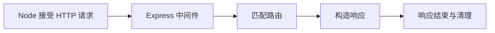

## 1. Express 位于哪一层

Express 是运行在 Node.js 上的 Web 框架，帮助组织路由、中间件和响应。Node 提供事件循环、网络与文件等运行能力，Express 不自动替你提供数据模型、登录系统或数据库事务。

本节以 **Express 5、Node.js 20+、ES Modules** 为实验基线。需要已理解 JavaScript 函数、Promise 与 HTTP 消息。单独创建实验目录，不把教学代码覆盖到当前项目服务。

## 2. 请求模型与关键对象

| 对象     | 作用                   | 最小观察                                       |
| -------- | ---------------------- | ---------------------------------------------- |
| app      | 应用及其中间件/路由栈  | app.get 注册 GET 处理器                        |
| req      | 当前请求及解析结果     | req.method、req.path                           |
| res      | 构造当前响应           | res.status(200).json(...)                      |
| next     | 把控制交给下一个处理器 | 不等于异步函数的 return                        |
| 事件循环 | 协调 JS 回调及异步事件 | 等网络时可处理别的请求，但 JS 计算仍会占用线程 |

异步 I/O 是把等待交给运行时；`async` 只是函数语法，不会自动把长循环送进后台线程。阻塞 JS 线程时，同一进程的其他请求也会等待。

## 3. 完整实验：追踪一次请求

先预测：/hello 请求的日志会按哪种顺序出现？建立目录后运行：

```sh
npm init -y
npm install express@5
# 保存下面代码为 server.mjs
node server.mjs
```

```js
import express from 'express';
const app = express();
app.use((req, res, next) => {
  console.log('1 entered', req.method, req.path);
  res.on('finish', () => console.log('3 finished', res.statusCode));
  next();
});
app.get('/health', (req, res) => res.json({ status: 'ok' }));
app.get('/hello', (req, res) => {
  console.log('2 handler');
  res.type('text/plain').send('hello');
});
const server = app.listen(4321, '127.0.0.1', () => console.log('ready:4321'));
process.on('SIGINT', () => server.close());
```

另一个终端执行 `curl -i http://127.0.0.1:4321/hello`。预期响应 200、文本 hello，日志依次 entered、handler、finished。finish 表示响应已交给底层发送流程，不是客户端业务一定读完；客户端断开等情况需要结合 close 和其他信号。结束按 Ctrl+C。



## 4. 阻塞和等待的区别

给处理器加 `await new Promise(resolve=>setTimeout(resolve,500))`，等待期间事件循环可以处理其他请求；改为忙循环直到 500ms 过去，整个 JS 执行线程被占用。两者耗时看似相同，对并发体验却不同。

不要把数据库同步等待、CPU 密集计算和 Promise 等待混在一起。CPU 密集任务应根据实际情况分拆、交给 worker 或独立任务系统；不是每个教学接口都需要复杂架构，但必须知道运行边界。

## 5. 失败案例与工程边界

如果处理器既不响应也不调用 next，请求会一直等到某处超时；如果先 send 又继续 next，后续处理器可能重复响应。修复时明确每条分支的终点，常用 `return res...` 结束当前 JS 函数，但 return 仍是语言控制流，不是 HTTP 协议动作。

示例只有一个进程，内存不是共享持久存储；多个进程各有状态。端口占用会导致启动失败，应处理 server 的 error 事件，而不是不断换端口掩盖进程管理问题。

## 6. 练习与验收

1. 加入一个延时接口，同时请求 /health，比较异步等待与忙循环。验收提供请求发起时间和完成顺序。
2. 添加一个故意漏 next 的中间件，定位挂起位置，再修复。验收每个分支都能明确响应或转交。
3. 在响应日志加入耗时与请求标识，验收不打印凭据或整个敏感请求体。

## 7. 资料链接

- [Express：Hello World](https://expressjs.com/en/starter/hello-world.html)
- [Express：中间件](https://expressjs.com/en/guide/using-middleware.html)
- [Node.js：不要阻塞事件循环](https://nodejs.org/en/learn/asynchronous-work/dont-block-the-event-loop)
