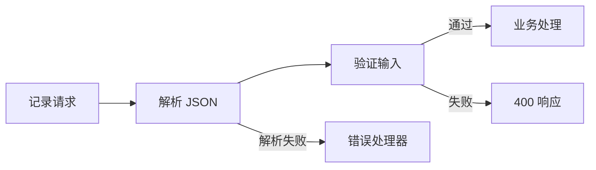

## 1. 中间件是执行链，不是注解

中间件得到 req、res 和 next，可以读取或修改请求上下文、响应、终止请求或转交控制权。它按注册顺序与路径匹配执行，因此顺序本身就是程序逻辑。

应用级中间件注册在 app，路由级注册在 Router；express.json 等是内置中间件，第三方中间件来自外部包。错误处理中间件则使用四参数签名，属于不同的处理分支。实验使用 Express 5、Node.js 20+。

## 2. 三种控制流必须区分

| 写法              | 做了什么           | 没做什么                 |
| ----------------- | ------------------ | ------------------------ |
| next()            | 转交后续正常处理   | 不会自动停止当前 JS 函数 |
| next(error)       | 转入后续错误处理   | 不等同于发送错误响应     |
| res.send/res.json | 发送并结束响应主体 | 不自动阻止你后续语句运行 |
| return ...        | 结束当前函数执行   | 不单独发送任何网络数据   |



## 3. 完整实验：解析和校验的顺序

先预测：把 express.json 放在处理器后面，req.body 会是什么？独立安装 `express@5`，保存 `middleware.mjs`：

```js
import express from 'express';
const app = express();
app.use((req, res, next) => {
  const started = performance.now();
  res.once('finish', () =>
    console.log(
      req.method,
      req.path,
      res.statusCode,
      Math.round(performance.now() - started),
    ),
  );
  next();
});
app.use(express.json({ limit: '2kb' }));
app.post(
  '/echo',
  (req, res, next) => {
    if (!req.body || typeof req.body.text !== 'string') {
      return res.status(400).json({ error: 'text required' });
    }
    res.locals.text = req.body.text.trim();
    next();
  },
  (req, res) => res.json({ text: res.locals.text }),
);
app.use((err, req, res, next) => {
  if (res.headersSent) return next(err);
  res
    .status(err.status === 413 ? 413 : 400)
    .json({ error: 'request body rejected' });
});
app.listen(4323, '127.0.0.1');
```

```sh
node middleware.mjs
curl -i -H 'Content-Type: application/json' -d '{"text":" hi "}' http://127.0.0.1:4323/echo
curl -i -H 'Content-Type: application/json' -d '{"text":7}' http://127.0.0.1:4323/echo
curl -i -H 'Content-Type: application/json' -d '{bad' http://127.0.0.1:4323/echo
```

预期 200 和 `{"text":"hi"}`、业务校验 400、JSON 解析错误 400；日志都有状态与耗时。最后的错误映射只适合这个小实验，在完整服务中应分类处理其他异常，避免把内部错误错报为客户端输入问题。结束后 Ctrl+C。

## 4. 上下文与生命周期

`res.locals` 适合保存本次响应的中间数据，不应当成跨请求共享数据库。模块级变量则会被同进程的请求共享，异步交错时可能互相覆盖。

finish 表示响应输出完成到相关发送阶段；close 也可能在连接提前关闭时发生。资源清理要根据真实资源生命周期实现，而且只执行一次。不要在每个请求给全局对象永久添加监听器；请求越来越多时会导致泄漏。

## 5. 故障案例

漏掉 next 和响应时，请求挂起；响应后仍 next 时，后续处理器可能报 headers already sent；调用 next 后又继续修改上下文时，可能与后续同步执行交错。应让分支清晰且 return 位置明确。

解析器只把字节变成对象，不证明对象合法或有权限。只检查 Content-Type 也不能代替大小限制、字段约束、身份和授权。

## 6. 练习与验收

1. 故意把 JSON 解析器移到路由后，再定位失效原因；验收说明注册时序，不使用全局变量绕过问题。
2. 增加请求标识与响应头，验收未知请求也可关联日志，但不信任无限长度的外部标识。
3. 为客户端提前断开设计清理逻辑，验收同一资源不会被重复释放，且正常请求同样释放。

## 7. 资料链接

- [Express：使用中间件](https://expressjs.com/en/guide/using-middleware.html)
- [Express：编写中间件](https://expressjs.com/en/guide/writing-middleware.html)
- [Node.js：HTTP 响应事件](https://nodejs.org/api/http.html)
