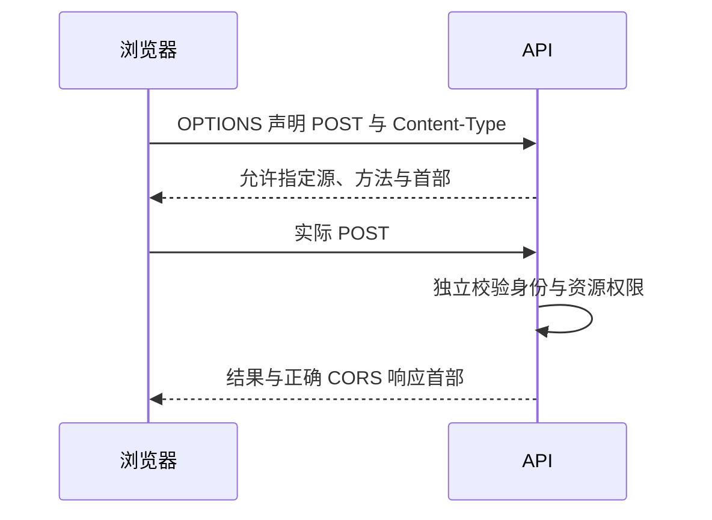

## 1. 三条不同的安全边界

**Cookie**是浏览器按规则存储和发送的状态；**会话**是应用把凭据关联到用户或登录状态的方案；**同源策略/CORS**约束浏览器脚本能否读取跨源响应。允许跨源读取不等于用户有权限，也不等于已经登录。

本节使用 Node.js 20+ 和现代浏览器。实验只在 127.0.0.1 的两个端口运行，不使用真实账号或生产 Cookie。

## 2. 术语与区别

| 概念       | 定义                                 | 关键边界                           |
| ---------- | ------------------------------------ | ---------------------------------- |
| origin     | scheme、host、port 组成的源          | 端口不同即不同源                   |
| site       | 与可注册域及 scheme 等相关的站点概念 | 跨源不必然跨站，不能混用           |
| HttpOnly   | 限制脚本直接读取 Cookie              | 不阻止脚本发起带 Cookie 的同源请求 |
| Secure     | 限制通过安全通道发送                 | 不是 Cookie 内容加密开关           |
| SameSite   | 限制部分跨站发送                     | 不是完整 CSRF 防护证明             |
| CSRF / XSS | 借用户状态发起非预期操作 / 注入脚本  | 攻击入口和防御层次不同             |

CORS 预检用 OPTIONS 询问是否允许某种跨源方法和首部。不是所有跨源请求都预检；某些请求可以先到服务器，再因响应缺少许可而被浏览器阻止脚本读取。因此服务端不能靠“浏览器会 CORS 拦截”阻止副作用。

## 3. 完整实验：请求到达和响应可读不同

先预测：服务端没给允许首部时，GET 日志是否仍出现？保存 `cors.mjs`：

```js
import http from 'node:http';
const page = `<!doctype html><meta charset="utf-8"><button>读取 API</button><pre></pre>
<script>document.querySelector('button').onclick=async()=>{try{const r=await fetch('http://127.0.0.1:4317/data');document.querySelector('pre').textContent=await r.text()}catch(e){document.querySelector('pre').textContent=e.message}};</script>`;
const front = http.createServer((req, res) => {
  res.setHeader('Content-Type', 'text/html');
  res.end(page);
});
const api = http.createServer((req, res) => {
  console.log('API received', req.method);
  if (process.env.ALLOW === '1')
    res.setHeader('Access-Control-Allow-Origin', 'http://127.0.0.1:4316');
  res.setHeader('Vary', 'Origin');
  res.end('API result');
});
front.listen(4316, '127.0.0.1');
api.listen(4317, '127.0.0.1');
```

运行 `node cors.mjs`，打开 `http://127.0.0.1:4316` 并点击。API 日志会有 GET，但浏览器脚本读取失败。Ctrl+C 后以 `ALLOW=1 node cors.mjs` 重启，点击可读到 API result。这里的请求不携带 Cookie，只证明跨源读取边界。

## 4. 凭据请求与预检时序



JSON POST 常触发预检。跨源 fetch 如需携带凭据，要配置 `credentials:'include'`，服务端还需正确的 Allow-Credentials 与具体 Allow-Origin，不能用 `*` 代替具体源；Cookie 自身的域、路径、SameSite、Secure 和浏览器第三方策略仍可能阻止发送。预检本身通常不携带这些跨源用户凭据，不应强制要求它已通过业务登录。

## 5. 错误与防御

反射任意 Origin 并允许凭据，相当于把私人响应开放给任意网站。应对允许源做精确匹配，并在动态返回源时设置 Vary。只检查 Referer 或只依靠 SameSite 也不应被描述为所有环境都足够；按威胁模型使用 CSRF token、Origin 校验、合理方法语义及再认证。

HttpOnly 可以减少凭据被脚本直接窃取的机会，但 XSS 仍可在页面权限下发起操作。防 XSS 需要输出编码、可信模板、输入处理和适当 CSP 等多层措施，不能用某一个 Cookie 标志代替。

## 6. 练习与验收

1. 把实验改为 JSON POST，观察 OPTIONS 与实际 POST。验收能明确“预检未通过”和“实际响应不可读”的区别。
2. 画出一个 CSRF 场景，指出攻击者控制什么、浏览器自动发送什么、服务端缺少哪一步验证。
3. 为 Cookie 会话列出 HttpOnly、Secure、SameSite、过期及服务端注销策略，验收解释各项不能防什么。

## 7. 资料链接

- [MDN：CORS](https://developer.mozilla.org/en-US/docs/Web/HTTP/Guides/CORS)
- [MDN：Cookie](https://developer.mozilla.org/en-US/docs/Web/HTTP/Guides/Cookies)
- [OWASP：CSRF 防护](https://cheatsheetseries.owasp.org/cheatsheets/Cross-Site_Request_Forgery_Prevention_Cheat_Sheet.html)
