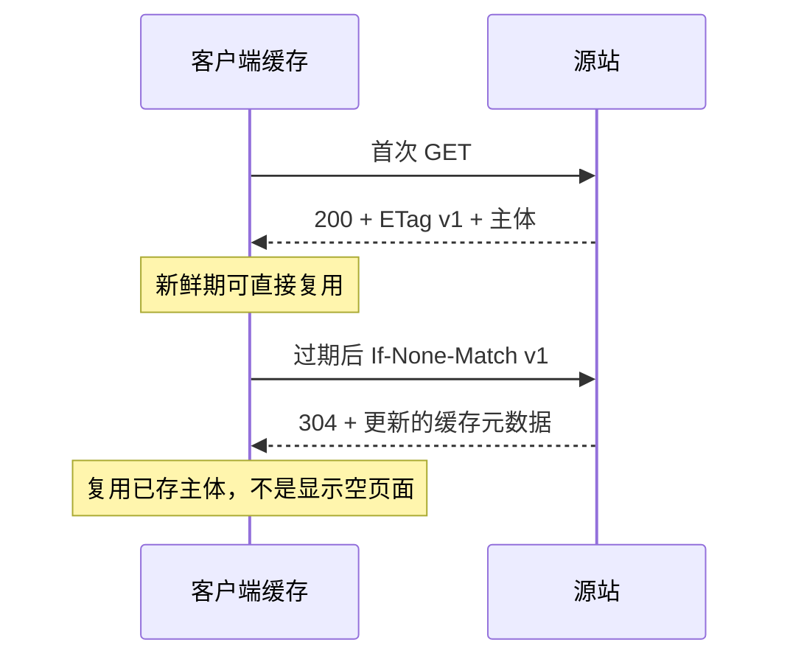

## 1. 缓存要先回答两个问题

**能不能存**与**现在能不能直接用**是不同问题。缓存可以位于浏览器、共享代理或 CDN。**新鲜度**决定已存表示是否可直接复用；**验证器**帮助缓存向源站询问旧表示是否仍有效。

需要先理解状态、首部和资源表示。以下实验是 Node.js 20+ 的可控教学服务，不依赖浏览器猜测缓存策略。

## 2. 术语与策略

| 字段          | 意义                         | 常见错误                             |
| ------------- | ---------------------------- | ------------------------------------ |
| max-age=60    | 允许按相关规则保持新鲜 60 秒 | 不是 60 秒后必须删除                 |
| no-cache      | 使用前需要成功验证           | 不是禁止存储                         |
| no-store      | 不应存储该消息               | 不保证清除所有早已存在的副本         |
| private       | 限制共享缓存存储             | 不等于加密或鉴权                     |
| ETag          | 表示的验证标识               | 不是必须等于文件哈希                 |
| Last-Modified | 最近修改时间验证器           | 时间精度可能不足以辨别短时间多次修改 |

缓存还要匹配请求方法、URL、Vary 维度及其他适用限制。不能看到 max-age 就忽略授权、请求指令或响应状态的缓存语义。

## 3. 时序：新鲜、过期与 304



304 不携带一份新的完整表示体；客户端根据已有响应和新元数据继续使用缓存。若源站返回 200 和 v2，则替换相应表示。浏览器开发工具显示的 transferred size、状态和“来自内存缓存”需要结合看，不能只看响应正文标签。

## 4. 完整实验：手动验证

先预测：第二次带正确 ETag 的请求是否仍下载正文？保存为 `cache.mjs`：

```js
import http from 'node:http';
const tag = '"lesson-v1"';
http
  .createServer((req, res) => {
    res.setHeader('ETag', tag);
    res.setHeader('Cache-Control', 'public, max-age=5');
    if (req.headers['if-none-match'] === tag) {
      res.writeHead(304);
      return res.end();
    }
    res.setHeader('Content-Type', 'text/plain; charset=utf-8');
    res.end('cached lesson');
  })
  .listen(4315, '127.0.0.1');
```

```sh
node cache.mjs
# 另一个终端
curl -i http://127.0.0.1:4315/
curl -i -H 'If-None-Match: "lesson-v1"' http://127.0.0.1:4315/
curl -i -H 'If-None-Match: "different"' http://127.0.0.1:4315/
```

预期结果如下：

| 请求       | 状态与主体          | 推导                   |
| ---------- | ------------------- | ---------------------- |
| 无验证器   | 200 + cached lesson | 发送当前表示           |
| 相同验证器 | 304，无表示体       | 已存版本仍有效         |
| 不同验证器 | 200 + 当前主体      | 不能继续假定旧版本相同 |

curl 在这个调用方式下不替你实现完整浏览器缓存，因此三条命令都是网络请求，实验展示的是条件请求语义。示例仅比较一个 ETag 字符串，生产实现还需处理标签列表、通配符和不同方法的前置条件规则。结束后 Ctrl+C。

## 5. 应用策略与故障

指纹静态资源如 app.hash.js 可设置长新鲜期，因为更新会换 URL；HTML 文档通常需要更及时地验证，以便引用新指纹资源。敏感用户页面必须结合授权与缓存隔离，不能为了命中率设为 public。

错误场景：根据 Accept-Language 返回中英文，却遗漏 Vary，导致共享缓存把中文版本给英文请求。修复要么用不同 URL 标识表示，要么正确声明协商维度。另一个错误是资源已变化但 ETag 不变，源站持续 304，用户永远看旧内容；验证器必须跟表示版本一起变。

## 6. 练习与验收

1. 将正文改为另一个版本，同时更新 ETag。验收旧标签请求得到 200，新标签得到 304。
2. 为个人资料、HTML 入口与指纹脚本选择三套策略，验收说明存储范围、新鲜度和更新机制。
3. 用浏览器测试普通刷新、禁用缓存与强制刷新，记录请求首部及实际传输，不以按钮名称替代证据。

## 7. 资料链接

- [MDN：HTTP 缓存](https://developer.mozilla.org/en-US/docs/Web/HTTP/Guides/Caching)
- [HTTP Caching（RFC 9111）](https://httpwg.org/specs/rfc9111.html)
