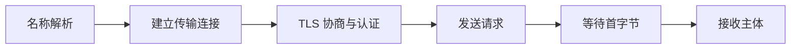

## 1. 语义相同不意味着传输相同

HTTP/1.1、HTTP/2 和 HTTP/3 继续表达请求、响应、方法与状态，但承载消息的方式不同。HTTPS 表示通过受保护的连接访问 HTTP，不是“HTTP/2”的另一个名字。版本越新也不意味着每个网络环境中都更快。

本节需要理解一次请求的基本层次。版本相关内容以各协议标准和当前客户端支持为准；本地实验使用 HTTP/1.1，不伪装成 TLS 或 HTTP/3 演示。

## 2. 连接与协议术语

| 术语     | 定义与作用                   | 边界                                    |
| -------- | ---------------------------- | --------------------------------------- |
| TCP      | 提供有序可靠字节流           | 丢包可能阻塞后续字节交付                |
| TLS      | 协商密钥、认证对端并保护传输 | 不自动修复应用越权或 XSS                |
| ALPN     | TLS 中协商应用协议的机制     | 是否采用 h2 取决于双方支持              |
| 多路复用 | 同一连接交错承载多个流       | 仍共享连接与拥塞资源                    |
| QUIC     | 基于 UDP 的安全传输协议      | HTTP/3 使用它，不能据此说 HTTP/3 不可靠 |

HTTP/1.1 可持久连接；HTTP/2 用二进制分帧与多流，但基于 TCP 时底层丢包仍可能影响多个流。HTTP/3 使用 QUIC，减少跨流的传输队头阻塞，但同一流缺失数据仍需等待，拥塞控制也不会消失。

## 3. 完整实验：观察连接复用

先预测：同一个客户端顺序发三个请求，服务器会记录几次新连接？保存为 `connections.mjs`：

```js
import http from 'node:http';
const server = http.createServer((req, res) => {
  res.end(`port=${req.socket.remotePort}`);
});
server.on('connection', (socket) =>
  console.log('new connection', socket.remotePort),
);
server.listen(4313, '127.0.0.1', async () => {
  const agent = new http.Agent({ keepAlive: true, maxSockets: 1 });
  const once = () =>
    new Promise((resolve, reject) => {
      http
        .get('http://127.0.0.1:4313/', { agent }, (res) => {
          let body = '';
          res.on('data', (chunk) => (body += chunk));
          res.on('end', () => {
            console.log(body);
            resolve();
          });
        })
        .on('error', reject);
    });
  try {
    await once();
    await once();
    await once();
  } finally {
    agent.destroy();
    server.close();
  }
});
```

运行 `node connections.mjs`。预期正常情况下看到一次 `new connection`，三个响应报告相同的客户端临时端口；脚本结束时主动销毁连接池并关闭服务器。把 agent 改为 `false` 再比较，会为每次请求建立独立连接。先完整读取响应，再复用连接，是本实验能稳定观察复用的重要条件。

## 4. 怎样阅读时间分解



图是新建 HTTPS 连接的概念顺序；DNS 缓存、连接复用、会话恢复和协议机制可以改变实际细节。**TTFB**通常包含服务器处理和网络往返等影响，不能当作纯数据库耗时。下载时间受主体大小、带宽和流控影响；解析和渲染又在网络之外。

## 5. TLS 与故障边界

证书链验证、主机名校验和信任根共同参与对端认证。使用 `-k` 忽略证书错误只能掩盖认证问题，不是正确修复。连接超时、TLS 错误、HTTP 状态和应用 JSON 错误属于不同层，日志应分开记录。

连接复用减少建立成本，但也需要管理空闲超时和对端关闭。代理可能对两侧分别选择不同协议，例如浏览器到代理是 h2，代理到源站是 h1；只看浏览器协议列不能推断全链路版本。

## 6. 练习与验收

1. 修改实验为并发请求并调整 maxSockets，验收解释连接数量由谁限制。
2. 在浏览器网络面板显示 Protocol 与 Timing，分别记录冷访问和复用访问，不要求数值完全一致，但要有条件说明。
3. 解释“HTTPS 可以防止应用 SQL 注入”为何错误，验收明确传输保护和应用输入边界的差别。

## 7. 资料链接

- [Node.js：HTTP Agent](https://nodejs.org/api/http.html#class-httpagent)
- [MDN：HTTP 连接管理](https://developer.mozilla.org/en-US/docs/Web/HTTP/Connection_management_in_HTTP_1.x)
- [HTTP/2（RFC 9113）](https://httpwg.org/specs/rfc9113.html)
- [HTTP/3（RFC 9114）](https://www.rfc-editor.org/rfc/rfc9114.html)
