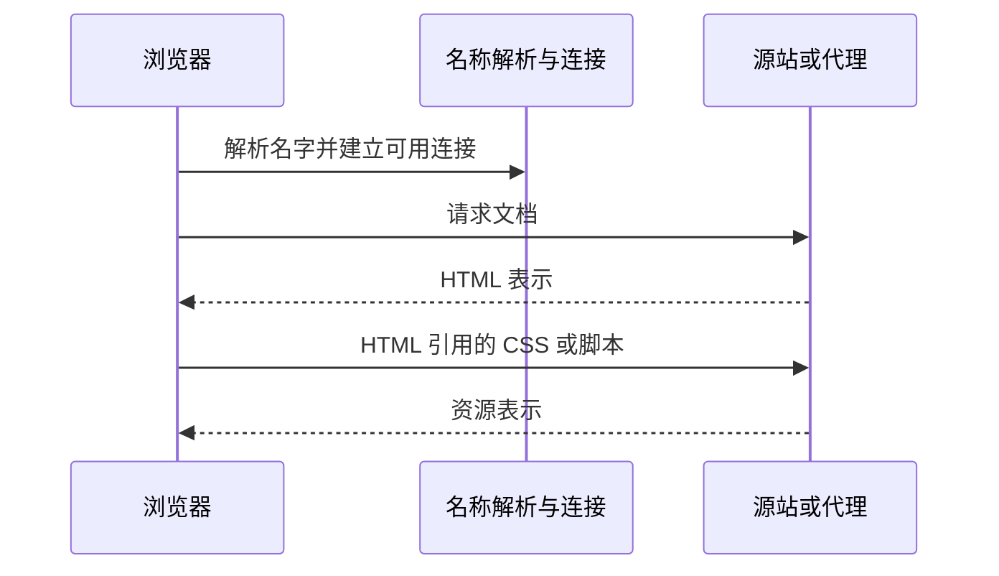

## 1. 一次访问中有哪些参与者

HTTP 定义客户端和服务器如何表达请求、响应与资源语义。客户端不一定是浏览器，服务器也可能是代理；同一个程序可以在一跳中当服务器，在下一跳中当客户端。**资源**是被访问的逻辑对象，**表示**是某次返回的具体内容，例如同一篇文章的 HTML 或 JSON。

前置要求是会打开终端和浏览器网络面板。示例使用 Node.js 20+ 的内置模块；没有外部依赖，不连接数据库。

## 2. URL 的组成与请求边界

对 `https://news.example:8443/articles/7?lang=zh#comments`：

| 部分              | 含义                         | 是否直接作为 HTTP 请求目标内容     |
| ----------------- | ---------------------------- | ---------------------------------- |
| https             | 访问方案，涉及安全连接等处理 | 决定如何建立访问，不是路径文本     |
| news.example:8443 | 主机与端口                   | 用于目标连接及 authority/Host 语义 |
| /articles/7       | 路径                         | 是                                 |
| ?lang=zh          | 查询                         | 是                                 |
| #comments         | 片段，通常用于客户端定位     | 不发送给服务器                     |

**DNS**把名字解析为地址；**TCP**或 QUIC 提供传输能力；**TLS**建立安全通信；HTTP 定义其上的应用消息。它们各自解决不同问题，DNS 成功不代表应用返回 200。



图中把连接准备压成一步以突出层次；缓存、连接复用和代理都可能让实际网络过程更短或增加中间跳。

## 3. 完整实验：服务器能看到片段吗

先预测：打开 `/article?q=css#bottom` 时，日志中的 URL 是否包含 `#bottom`？保存为 `model.mjs`：

```js
import http from 'node:http';
const server = http.createServer((req, res) => {
  const url = new URL(req.url, 'http://127.0.0.1:4311');
  console.log(req.method, req.url);
  res.setHeader('Content-Type', 'application/json; charset=utf-8');
  res.end(
    JSON.stringify({
      path: url.pathname,
      query: url.search,
      fragment: url.hash,
    }),
  );
});
server.listen(4311, '127.0.0.1', () => console.log('ready:4311'));
```

```sh
node model.mjs
# 另一个终端
curl 'http://127.0.0.1:4311/article?q=css#bottom'
```

预期响应为 `{"path":"/article","query":"?q=css","fragment":""}`。服务器收到 `/article?q=css`，片段留在客户端。实验结束在启动终端按 Ctrl+C。

## 4. 从请求到页面不是一步完成

浏览器先得到文档，再解析、加载依赖并执行脚本；脚本还可能继续请求数据。一次页面“加载慢”可能来自名称解析、握手、服务端等待、下载、脚本执行或渲染。Network 面板主要解释网络阶段，不能单靠它证明某个 JS 计算快。

URL 路径不必对应磁盘文件。`/articles/7` 可能由程序查询数据库生成，也可能经缓存返回；不要用文件系统路径模型推断所有 Web 路由。代理可能终止客户端连接并另开到源站的连接，因此 HTTP 端到端语义不等于只有一条物理连接。

## 5. 错误驱动与边界

错误假设是把 `?next=a&b=c` 整体当作 next 的值。查询参数需要按 URL 语法编码，`&` 默认分隔参数；在 JS 中使用 URL 与 URLSearchParams 组装，避免手拼后产生注入或截断。路径中的 `%2F` 如何处理还取决于服务器和路由层，不要在每一层重复解码。

若 curl 连接失败，先确认监听地址和端口；如果返回 JSON 但页面异常，再检查表示格式和前端处理；如果 404，连接通常已经成功，问题进入了应用路由层。按层次排错能避免把所有失败统称为“网络不通”。

## 6. 练习与验收

1. 用 URLSearchParams 构造值包含空格与 `&` 的查询，验收服务器能完整读回原值。
2. 在浏览器访问实验 URL，比较地址栏、Network 的请求 URL 与服务端日志，解释片段差异。
3. 为一个真实页面画出文档、样式、脚本和数据请求依赖图，至少指出一次连接复用或缓存现象，不能只画单请求箭头。

## 7. 资料链接

- [MDN：HTTP 概览](https://developer.mozilla.org/en-US/docs/Web/HTTP/Guides/Overview)
- [Node.js：HTTP 模块](https://nodejs.org/api/http.html)
- [MDN：URL](https://developer.mozilla.org/en-US/docs/Web/API/URL)
