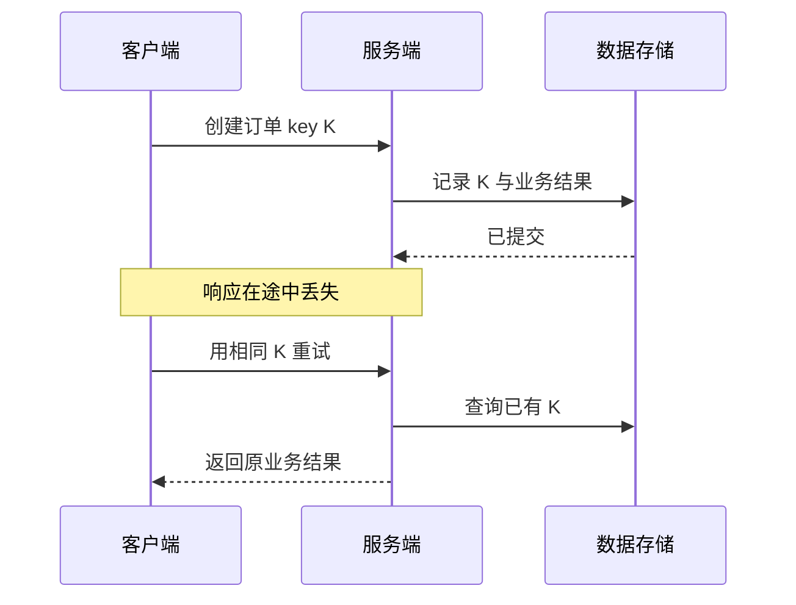

## 1. 失败发生在哪一跳

代理接收客户端请求，再代表客户端访问上游；网关可能转换协议或聚合服务。每一跳都有连接、超时和失败边界。客户端收到 504 时，不能据此断言业务没有执行；它可能已提交，只是结果未及时返回。

前置是理解方法、连接与状态。重点是**总时间预算**、**幂等**和**可观测性**，而不是无条件“失败就重试”。

## 2. 三种容易混淆的超时

| 超时                | 等待什么           | 是否证明操作未执行             |
| ------------------- | ------------------ | ------------------------------ |
| 连接超时            | 建立到目标的连接   | 只说明本次连接未按时完成       |
| 响应/读取超时       | 等首字节或后续数据 | 否，服务器可能还在工作         |
| 总截止时间 deadline | 整个调用与重试预算 | 否，取消传播是否到达要独立处理 |

502 通常表示网关从上游得到无效响应，503 表示暂时不可用，504 表示网关等上游超时。具体部署可能自定义错误映射，排查应检查代理日志和请求标识，不只看一条状态文本。

## 3. 完整实验：客户端取消不等于服务端回滚

先预测：客户端 100ms 后放弃，服务器 500ms 后的日志是否仍出现？保存为 `timeout.mjs`：

```js
import http from 'node:http';
const server = http.createServer((req, res) => {
  setTimeout(() => {
    console.log('server work finished');
    res.end('done');
  }, 500);
});
server.listen(4318, '127.0.0.1', async () => {
  try {
    await fetch('http://127.0.0.1:4318/', { signal: AbortSignal.timeout(100) });
  } catch {
    console.log('client stopped waiting');
  }
  setTimeout(() => server.close(), 800);
});
```

运行 `node timeout.mjs`，预期先出现 client stopped waiting，后出现 server work finished。脚本会自行关闭服务器。这里的工作只是计时器，真实数据库写入要通过事务、取消机制和业务补偿设计处理，不能依赖 HTTP 连接关闭自动撤销。

## 4. 为什么重试可能重复扣款



**幂等键**需要与请求指纹、状态及结果绑定。相同键不同参数应拒绝或明确处理；并发重试需要唯一约束或原子协调；记录有效期必须覆盖实际重试窗口。只把键存在内存里，进程重启后仍可能重复执行。

## 5. 设计重试策略

先判断失败是否可重试，再限制次数、采用指数退避与抖动，遵守合理的 Retry-After，并把所有等待和重试计入同一 deadline。不要在代理、SDK、业务层各重试三次而不协调，否则会乘法放大上游压力。

转发首部如 X-Forwarded-For 来自网络输入，只有经过明确可信代理边界才能用于安全判断。对日志中的请求 ID 也应校验长度与格式，避免任意输入污染日志；不要记录令牌和完整敏感主体。

## 6. 失败复盘与练习

1. 将实验延迟改为随机值，记录每次超时与服务端完成的关系。验收不再把超时归类为“业务肯定失败”。
2. 设计创建订单的幂等表结构和并发流程。验收覆盖同键同参、同键异参、处理中、提交后丢响应四种情况。
3. 给三跳调用分配 2 秒总预算，写出每层的剩余时间传递和重试上限，验收重试总时长不会无限延长。

## 7. 资料链接

- [MDN：HTTP 代理](https://developer.mozilla.org/en-US/docs/Web/HTTP/Proxy_servers_and_tunneling)
- [Node.js：AbortSignal](https://nodejs.org/api/globals.html#class-abortsignal)
- [HTTP Semantics](https://httpwg.org/specs/rfc9110.html)
