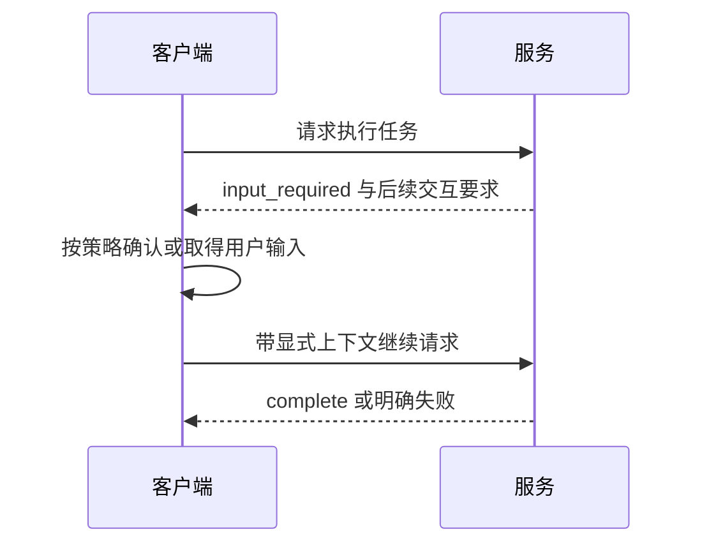

## 1. 复杂交互必须按支持能力渐进启用

进度、取消、订阅、表单式补充输入和根目录信息，可以改善长任务与客户端交互，但会增加生命周期和权限复杂度。先确认目标版本、客户端能力和扩展支持，再决定是否启用。

本节基线 2026-07-28。新版把服务器需要客户端输入的交互放进 MRTR（多轮请求往返）结果模型；旧版服务端直接发请求的示例只适用于对应旧代际。扩展目录会演进，不能把所有可选功能都写成每个客户端必有。

## 2. 能力的用途和边界

| 机制          | 用途                        | 失败时要回答的问题                     |
| ------------- | --------------------------- | -------------------------------------- |
| progress      | 告知进行中工作状态          | 进度不再变化是否超时？最终结果在哪里？ |
| cancellation  | 表示调用方不再等待/需要工作 | 服务能否及时停止？副作用是否已发生？   |
| sampling      | 由客户端控制的模型推理能力  | 用户策略和数据边界是否允许？           |
| elicitation   | 取得必要用户输入            | 是否试图索取不该收集的敏感信息？       |
| roots         | 描述客户端可提供的根范围    | 不是对任意路径的授权证明               |
| subscriptions | 监听相关变更                | 断开后怎样重新建立并重新同步？         |

**版本注意：sampling 自 2026-07-28 起已弃用，新实现不应采用，应按官方迁移建议直接集成模型提供方 API；现有实现需按能力声明与迁移计划处理。表中保留它是为了识别旧集成，不代表推荐新增。**

能力声明只是协商输入，不是完整安全授权。roots 允许的目录也不能绕过文件系统权限和路径规范化。

## 3. MRTR 的状态模型



图解释控制流，不给未经核对的完整序列化格式。真正字段、句柄、交互类型及有效性必须按目标规范与 SDK 校验，不能随意造一个 resumeToken 就当兼容实现。

## 4. 完整可运行状态机实验

先预测：用户拒绝后，再次提交确认是否应重新执行？保存 `interaction.mjs`：

```js
import assert from 'node:assert/strict';
function transition(state, event) {
  if (state.status === 'complete' || state.status === 'cancelled') return state;
  if (event.type === 'cancel') return { ...state, status: 'cancelled' };
  if (state.status === 'running' && event.type === 'need-input')
    return { ...state, status: 'waiting' };
  if (
    state.status === 'waiting' &&
    event.type === 'input' &&
    event.approved === true
  )
    return { ...state, status: 'complete', value: 'read-only report' };
  if (state.status === 'waiting' && event.type === 'input')
    return { ...state, status: 'cancelled' };
  throw new Error('invalid transition');
}
const waiting = transition(
  { status: 'running', id: 'job-1' },
  { type: 'need-input' },
);
assert.equal(waiting.status, 'waiting');
const denied = transition(waiting, { type: 'input', approved: false });
assert.equal(
  transition(denied, { type: 'input', approved: true }).status,
  'cancelled',
);
const done = transition(waiting, { type: 'input', approved: true });
assert.equal(done.status, 'complete');
console.log('waiting, approval, denial and terminal state verified');
```

运行 `node interaction.mjs`。这是应用状态机，不是把自定义 event 当 MCP 线上消息；它训练“已拒绝的终态不能被迟到事件重新激活”。真实服务还要限制句柄有效期、绑定身份、控制重放和清理等待资源。

## 5. 取消和通知的边界

stdio 的取消通过引用请求 id 的通知表达；新版 HTTP 绑定的取消遵循相关响应流关闭语义。收到取消不证明已提交的外部写入撤销，服务需要定义中止点与幂等策略。

请求范围内进度与长期变更订阅是不同通道。网络重连后不能假设漏掉的通知自动补齐；按规范重新订阅，并在需要时重新读取权威列表/资源。未知扩展或不支持输入类型应降级或明确拒绝，不得悄悄执行权限更大的替代操作。

## 6. 练习与验收

1. 给状态机加入过期与身份绑定，验收另一个用户或过期句柄不能继续任务。
2. 设计取消发生在提交前和提交后两套结果，验收文案不错误承诺“全部撤销”。
3. 为三个真实目标客户端列出能力矩阵，验收区分已实测、文档声明和未验证，不只用勾号猜测支持。

## 7. 资料链接

- [MCP：基础消息与交互模型](https://modelcontextprotocol.io/specification/2026-07-28/basic)
- [MCP：传输与取消](https://modelcontextprotocol.io/specification/2026-07-28/basic/transports)
- [MCP：Sampling 弃用说明](https://modelcontextprotocol.io/specification/2026-07-28/client/sampling)
- [MCP：扩展目录](https://modelcontextprotocol.io/extensions)
