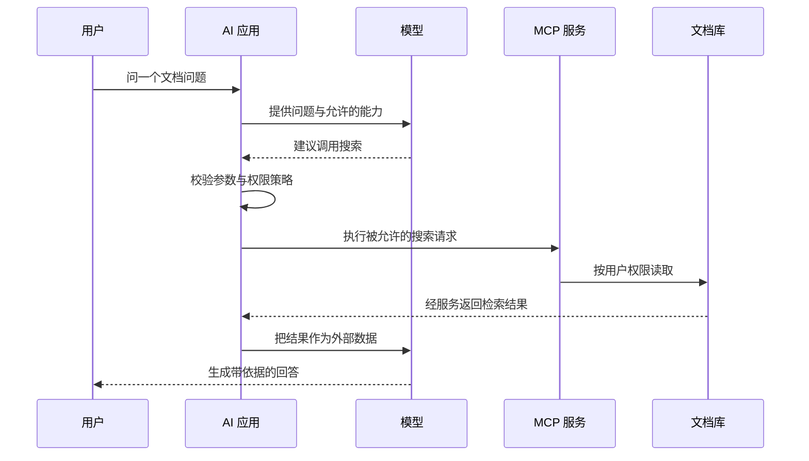

## 1. MCP 解决的是能力接入协议

MCP（Model Context Protocol）标准化 AI 应用与外部能力之间的通信。它让应用发现工具、读取上下文和使用提示模板，而不是要求每个应用为每个服务编写完全不同的通信协议。模型本身并不会因为看到一个 MCP 地址就自动获得权限或执行能力。

本模块按 **2026-10-18 核对的 2026-07-28 规范**讲解；旧版 2025-11-25 及更早版本使用的初始化会话模型会单独对照。不能把旧示例中的 initialize、省略元数据等写法直接当作新版完整请求。

## 2. 先划清四层边界

| 层次           | 负责什么                               | 不负责什么                   |
| -------------- | -------------------------------------- | ---------------------------- |
| 模型           | 依据上下文生成回答或工具调用意图       | 不直接持有全部系统权限       |
| AI 应用        | 编排、选择可用能力、执行策略与用户界面 | 不能把模型建议自动视为授权   |
| MCP 协议与实现 | 消息、能力发现、调用与相关交互         | 不代替业务授权和外部系统规则 |
| 外部服务       | 实际文件、数据库或业务操作             | 不应盲信来自模型的参数       |

协议降低集成差异，但不保证所有客户端支持所有能力。版本、扩展、安全策略、资源格式和界面仍需要逐项核对。

## 3. 一次知识库查询的执行图



关键不是箭头多，而是模型意图和真正执行之间存在应用决策，服务读取时还存在资源级授权。文档内容即使含“忽略所有规则”，也只是外部数据。

## 4. 可运行实验：意图不等于执行

先预测：模型建议的写操作是否应该执行？保存为 `policy.mjs`，运行 `node policy.mjs`：

```js
import assert from 'node:assert/strict';
const offered = new Set(['search_docs']);
const calls = [];
function executeSuggestion(suggestion, user) {
  if (!offered.has(suggestion.name)) return { rejected: 'not offered' };
  if (!user.canRead) return { rejected: 'not authorized' };
  if (typeof suggestion.query !== 'string' || suggestion.query.length > 100)
    return { rejected: 'invalid query' };
  calls.push(suggestion.query);
  return { documents: [{ id: 'guide', text: 'external data' }] };
}
assert.equal(
  executeSuggestion({ name: 'delete_docs', query: 'all' }, { canRead: true })
    .rejected,
  'not offered',
);
assert.equal(
  executeSuggestion({ name: 'search_docs', query: 'cache' }, { canRead: false })
    .rejected,
  'not authorized',
);
assert.equal(
  executeSuggestion({ name: 'search_docs', query: 'cache' }, { canRead: true })
    .documents.length,
  1,
);
assert.deepEqual(calls, ['cache']);
console.log('intent, policy and execution are separate');
```

这是应用策略实验，不是 MCP 服务，也不实现协议传输。它验证两次拒绝都未到达执行记录，避免把“模型说要调用”当成“已经合法执行”。

## 5. 何时选择 MCP

需要多个 AI 客户端统一接入能力、清晰的发现/调用契约、可复用上下文入口时，MCP 有价值。单一固定业务 HTTP 接口也可能直接调用更简单；MCP 不会消除业务 API、数据治理或运维成本。

同样，工具声明为只读只是能力描述，不能取代服务端真正限制写入。服务自报名称和说明不是经过验证的安全身份。接入第三方服务前要核对代码来源、权限范围、日志和网络出口。

## 6. 常见错误与练习

1. 为“搜索并删除旧文档”划分只读与写入权限，验收写操作有独立授权和用户确认策略。
2. 把恶意指令放进实验文档文本，验收应用仍按数据处理，不把它提升为系统指令。
3. 比较直接 HTTP API 与 MCP 接入的成本，验收列出复用收益和新增兼容/安全责任，而不是笼统选更流行的方案。

## 7. 资料链接

- [MCP：架构](https://modelcontextprotocol.io/docs/2026-07-28/learn/architecture)
- [MCP：2026-07-28 规范](https://modelcontextprotocol.io/specification/2026-07-28)
- [MCP：版本与兼容](https://modelcontextprotocol.io/specification/2026-07-28/basic/versioning)
