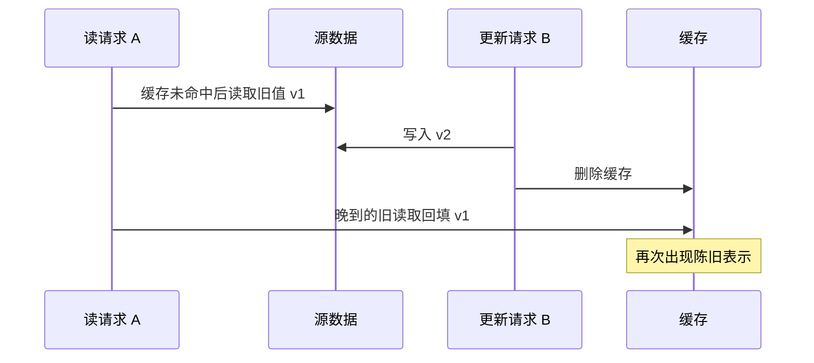

## 1. 缓存首先是一致性与容量设计

Cache-aside 的基本流程是先查缓存，未命中读源数据并回填；写入通常先更新权威数据，再使相关缓存失效。它减少读取成本，但不能自动保证严格一致。必须先声明允许多陈旧、缓存失效时源站能承受多少流量。

本节通过可运行的内存替身验证控制流，不连接 Redis 或数据库。替身不模拟 TTL、淘汰或网络故障的全部语义，只让业务分支可观察。

## 2. 四类故障分别解决

| 问题     | 发生条件                       | 常见措施及边界                           |
| -------- | ------------------------------ | ---------------------------------------- |
| 穿透     | 不存在的数据持续请求源站       | 负缓存、入口校验；仍要限制键空间与有效期 |
| 击穿     | 热点键失效并发回源             | 同请求合并或受控重建；锁自身也可能失败   |
| 雪崩     | 大量键同时失效或缓存整体不可用 | TTL 抖动、限流、降级、源站保护           |
| 陈旧覆盖 | 旧读取晚于新写入回填           | 版本控制或明确一致性协议；TTL 只限制窗口 |

负缓存需要区分“确实不存在”和“上游超时”。把错误缓存成不存在，会把短暂故障变成持续错误结果。

## 3. 完整实验：命中、负缓存与失效

先预测：同一不存在 id 连续读取是否需要每次回源？保存 `cache-aside.mjs`：

```js
import assert from 'node:assert/strict';
const cache = new Map();
const source = new Map([['1', { version: 1, title: 'A' }]]);
const missing = Symbol('missing');
let reads = 0;
async function get(id) {
  if (cache.has(id)) {
    const value = cache.get(id);
    return value === missing ? null : value;
  }
  reads++;
  const value = source.get(id) ?? null;
  cache.set(id, value ?? missing);
  return value;
}
async function update(id, title) {
  const old = source.get(id);
  source.set(id, { version: (old?.version ?? 0) + 1, title });
  cache.delete(id);
}
assert.equal((await get('1')).title, 'A');
assert.equal((await get('1')).title, 'A');
assert.equal(reads, 1);
assert.equal(await get('none'), null);
assert.equal(await get('none'), null);
assert.equal(reads, 2);
await update('1', 'B');
assert.equal((await get('1')).title, 'B');
console.log('hit, negative cache and invalidation verified');
```

运行 `node cache-aside.mjs`，预期打印验证成功。使用 has 而不是 truthiness，避免把合法 0、false、空字符串当未命中。实际 Redis 中要定义负缓存的序列化标记及短 TTL，并限制大小。

## 4. 并发下旧值怎样重新出现



先删缓存再写源也有其他竞争窗口。延迟双删、加锁等只能在具体假设下减少某类窗口，不应作为所有故障模型的强一致证明。版本比较、按版本命名键、事件驱动失效或直接绕过缓存各有成本，应按业务一致性需求选择。

## 5. 故障降级与过期策略

给所有键统一整点过期会制造尖峰；适量抖动分散重建，但不能超出业务允许陈旧时间。缓存不可用时无条件全量回源也可能压垮数据库，应限制并发、保留合适旧值或拒绝次要功能。

请求合并要在失败后清理进行中 Promise，并考虑同进程与跨进程的区别；一个进程内的 Map 不会自动协调其他实例。真正需要交易正确性的库存和余额，不应只靠展示缓存决定。

## 6. 练习与验收

1. 给替身加入 TTL 和伪时钟，验收不使用 sleep 即能测试失效窗口。
2. 按时序图手动控制两个 Promise，复现旧值回填，验收明确哪个假设被破坏。
3. 设计缓存整体不可用的降级，验收给出回源并发上限、陈旧数据边界与可观察指标。

## 7. 资料链接

- [Redis：客户端缓存与一致性](https://redis.io/docs/latest/develop/reference/client-side-caching/)
- [Redis：淘汰策略](https://redis.io/docs/latest/develop/reference/eviction/)
