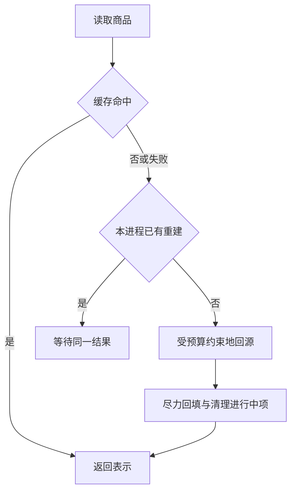

## 1. 综合任务：商品详情缓存

为商品详情设计缓存服务，明确权威数据、允许陈旧窗口、键结构、TTL、并发重建、故障降级和监控。库存展示可以短暂陈旧，交易扣库存仍由权威事务决定；不要把两者放在同一正确性承诺里。

本节提供完全可运行的 Node.js 控制流实验，用 Map 和可注入故障代替 Redis 与数据库。真实 Redis 接入需要用同一接口实现 GET/SET EX、序列化、超时和连接生命周期，不能只替换函数名就假定语义相同。

## 2. 先声明业务口径

| 项目       | 本实验约定                             |
| ---------- | -------------------------------------- |
| 缓存键     | product:v1:<id>，版本用于表示结构演进  |
| TTL        | 由缓存适配器负责，本替身不实现真实过期 |
| 未命中     | 读取源并回填                           |
| 同进程并发 | 合并相同 id 的进行中读取               |
| 缓存失败   | 降级回源，生产还必须限制回源并发       |
| 源不存在   | 返回 null，不把异常当不存在            |

## 3. 完整实验：重建合并和失败清理

先预测：十个同时请求应读取源几次？源第一次失败后，下一次还能重试吗？保存 `redis-project.mjs`：

```js
import assert from 'node:assert/strict';
function createReader({ cache, source }) {
  const inflight = new Map();
  return async (id) => {
    const key = `product:v1:${id}`;
    let cached;
    try {
      cached = await cache.get(key);
    } catch {
      cached = undefined;
    }
    if (cached !== undefined) return cached;
    if (inflight.has(key)) return inflight.get(key);
    const pending = (async () => {
      const value = await source(id);
      if (value !== null) {
        try {
          await cache.set(key, value);
        } catch {}
      }
      return value;
    })();
    inflight.set(key, pending);
    try {
      return await pending;
    } finally {
      if (inflight.get(key) === pending) inflight.delete(key);
    }
  };
}
const data = new Map();
let reads = 0;
const get = createReader({
  cache: {
    get: async (key) => data.get(key),
    set: async (key, value) => data.set(key, value),
  },
  source: async (id) => {
    reads++;
    await new Promise((r) => setTimeout(r, 10));
    return { id, name: 'book' };
  },
});
const result = await Promise.all(Array.from({ length: 10 }, () => get('1')));
assert.equal(reads, 1);
assert.equal(result.length, 10);
let attempts = 0;
const retry = createReader({
  cache: { get: async () => undefined, set: async () => {} },
  source: async () => {
    if (++attempts === 1) throw new Error('source failed');
    return { id: '2' };
  },
});
await assert.rejects(retry('2'), /source failed/);
assert.equal((await retry('2')).id, '2');
console.log('coalescing and failure cleanup verified');
```

运行 `node redis-project.mjs`，预期通过断言并打印验证结果。finally 清理进行中项，防止某次失败后永远复用已拒绝的 Promise。

## 4. 结果不意味着哪些保证

进行中 Map 只在一个进程内共享，多实例仍可能同时回源；示例没有过期、淘汰、网络超时和容量限制。生产缓存异常不能全部悄悄忽略，至少要有指标和采样日志，同时避免日志风暴与敏感信息泄露。



## 5. 更新、一致性与故障测试

数据库更新与缓存删除之间会有竞争窗口；按允许陈旧时间选择失效/版本策略。缓存不可用时，源站保护比“所有请求都尽力成功”更重要。为读超时、写缓存失败、源失败、空结果、热键同时过期和网络恢复分别建立用例。

容量估算至少包括键和值平均大小、数量、过期分布与结构开销；不能只用 JSON 字符串长度当实例实际内存。观察命中率、回源次数、延迟、错误、内存与重建并发。

## 6. 练习与交付验收

1. 注入带伪时钟的 TTL 适配器，验收过期后并发仍合并且旧任务不会清理新任务。
2. 缓存与源分别注入超时/失败，验收失败类别明确，回源有总预算与并发上限。
3. 提交键设计、更新竞争时间线、容量估算与降级策略，验收明确哪些库存只供展示、哪些由交易系统判断。
4. 选择隔离 Redis 替换适配器再验证，保留运行版本、测试条件和差异，不操作现有项目实例。

## 7. 资料链接

- [Redis：缓存与淘汰](https://redis.io/docs/latest/develop/reference/eviction/)
- [Redis：复制边界](https://redis.io/docs/latest/operate/oss_and_stack/management/replication/)
- [Redis：客户端指南](https://redis.io/docs/latest/develop/clients/)
